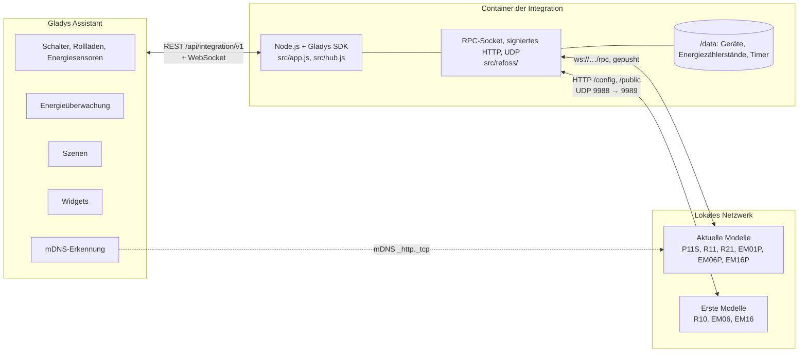
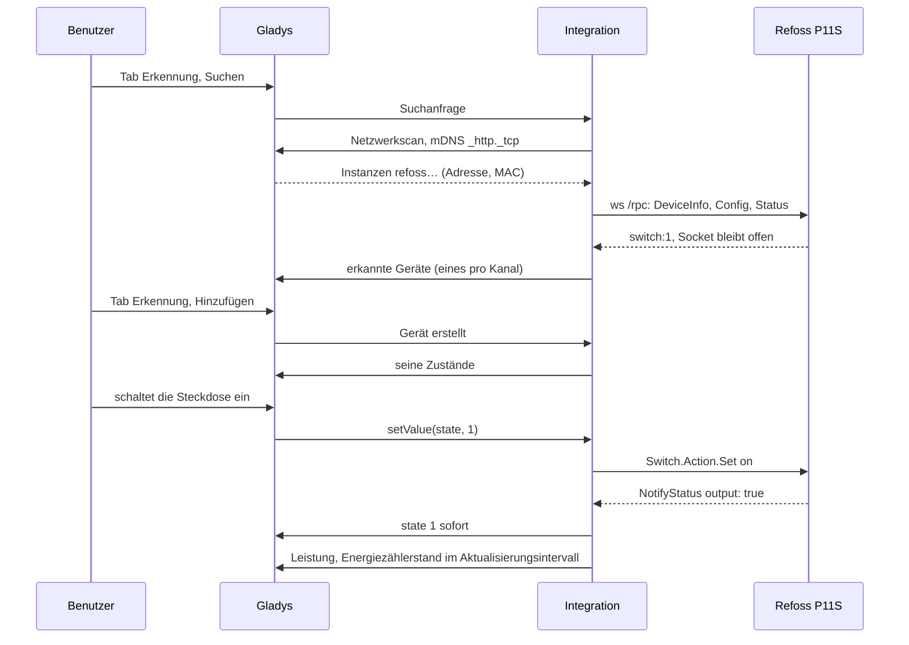
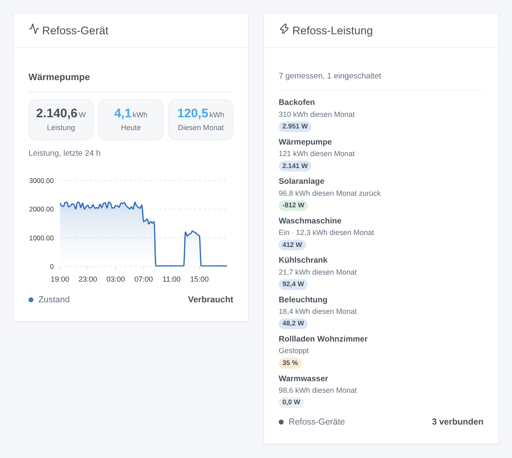

# Refoss für Gladys Assistant

[English](README.md) | [Français](README.fr.md) | **Deutsch** | [Español](README.es.md)

[](LICENSE)
[](https://github.com/William-De71/gladys-refoss/releases)
[](https://github.com/William-De71/gladys-refoss/actions/workflows/release.yml)
[](https://gladysassistant.com)


Ihre Refoss-Steckdosen, -Relais, -Rollladenmodule und -Energiemessgeräte in Gladys Assistant, im lokalen Netzwerk, ohne die Refoss-Cloud. Jede Steckdose, jeder Rollladen und jede Stromzange wird zu einem Gladys-Gerät – mit Energiezählerständen, die direkt in die Energieüberwachung von Gladys einfließen, zwei Widgets sowie Tastendrücken und Schutzabschaltungen als Szenen-Auslöser. Inoffiziell, keine Verbindung zu Refoss.

## Funktionen

- **Beide Generationen von Refoss-Geräten**: Die aktuellen Modelle (Steckdose P11S, Relais R11 und R21, Energiemessgeräte EM01P, EM06P und EM16P) werden über die mDNS-Erkennung von Gladys automatisch gefunden, die ersten Modelle (Relais R10, Energiemessgeräte EM06 und EM16) unter den IP-Adressen, die Sie eingeben.
- **Ein Gerät pro Kanal**: eine Steckdose oder ein Relais (Ein / Aus, dazu Leistung, Spannung, Strom und Energie bei Modellen mit Messfunktion), ein an einem R11 oder R21 angeschlossener Rollladenmotor (Öffnen / Stopp / Schließen, Position nach der Kalibrierung), eine Stromzange eines Energiemessgeräts (Leistung, Spannung, Strom, verbrauchte und zurückgespeiste Energie), benannt wie in der Refoss-App.
- **Energiezählerstände für Gladys**: Die Zähler der Geräte beginnen jeden Monat bei null; die Integration macht daraus Zählerstände, die nur steigen und Neustarts überdauern – die Energieüberwachung von Gladys kann sie aufsummieren und mit Kosten versehen.
- **Gepushte Zustände**: Ein aktuelles Modell meldet jede Änderung über seinen lokalen WebSocket; Ein / Aus und Rollläden kommen sofort in Gladys an, Messwerte im Aktualisierungsintervall von 10, 30 oder 60 Sekunden.
- **Zwei Dashboard-Widgets**: alle Steckdosen und Zangen auf einen Blick, die größten Verbraucher zuerst; ein einzelnes Gerät mit seiner aktuellen Leistung, heute, diesem Monat und seiner Leistungskurve der letzten 24 Stunden.
- **Vier Szenen-Auslöser** (ein Taster an einem Geräteeingang wird gedrückt, ein Schutz löst aus, ein Gerät ist weg, ein Gerät ist zurück) und **zwei Szenen-Aktionen** (eine Steckdose für einige Minuten einschalten, die Energiezähler lesen).
- Ein in der Refoss-App gesetztes Passwort wird unterstützt. Alles bleibt im lokalen Netzwerk.
- Englisch, Französisch, Deutsch und Spanisch.

## Funktionsweise




**Aktuelle Modelle.** Gladys durchsucht im Host-Netzwerk den mDNS-Dienst `_http._tcp` und leitet die Antworten weiter; die Integration behält die Instanzen mit dem Namen `refoss<model>-<MAC>` (der Filter der offiziellen Refoss-Integration für Home Assistant). Anschließend öffnet sie den WebSocket `ws://<address>/rpc` jedes Geräts und ruft `Refoss.DeviceInfo.Get`, `Refoss.Config.Get` und `Refoss.Status.Get` auf; danach pusht das Gerät `NotifyStatus` (was sich geändert hat) und `NotifyEvent` (Tastendrücke). Befehle sind `Switch.Action.Set`, `Cover.Action.Set` und `Cover.Pos.Set`. Hat das Gerät ein Passwort, antwortet es mit 401 und einer Challenge, und die Aufrufe enthalten einen SHA-256-Digest aus dem Benutzer `admin` und Ihrem Passwort.

**Erste Modelle.** Sie beantworten eine UDP-Suche (Port 9988) an den festen Port 9989 des Absenders, den der vermittelte Netzwerkscan von Gladys nicht empfangen kann: Die Integration fragt die von Ihnen eingegebenen Adressen deshalb selbst aus ihrem Container ab. Danach werden sie im Aktualisierungsintervall per HTTP mit signierten Nachrichten gelesen (`Appliance.Control.ToggleX`, `Appliance.Control.ElectricityX`).




### Geräte und Funktionen

| Kanal                                                  | Gladys-Gerät                                | Funktionen                                                                                          |
| ------------------------------------------------------ | ------------------------------------------- | --------------------------------------------------------------------------------------------------- |
| Steckdose oder Relais (P11S, R11, R21, R10)            | `switch`                                    | `state` (`binary`)                                                                                  |
| … mit Messfunktion (P11S, Relais, die Leistung melden) | + `switch`, `energy-sensor`                 | `power` (W), `voltage` (V), `current` (A), `energy` (`index`, kWh)                                  |
| Rollladenmotor (R11, R21 im Rollladenmodus)            | `shutter`                                   | `state` (−1 schließen, 0 Stopp, 1 öffnen), `position` (% offen, nach der Kalibrierung)              |
| Stromzange (EM01P, EM06, EM06P, EM16, EM16P)           | `energy-sensor`, `energy-production-sensor` | `power` (W, unter 0 bei Rückspeisung), `voltage`, `current`, `energy` und `returned` (`index`, kWh) |

Externe IDs: `ext:<selector>:switch:<MAC>-switch<n>`, `…:cover:<MAC>-cover<n>`, `…:meter:<MAC>-em<n>`; Funktionen `…:state`, `…:position`, `…:power`, `…:voltage`, `…:current`, `…:energy`, `…:returned`. Die Zangen behalten die Namen aus der Refoss-App, andernfalls den Namen des Geräts und der Zange (`A1`, `B1`…).

**Energiezählerstände.** Gladys braucht einen Zählerstand, der niemals sinkt. Die Integration folgt dem Gesamtzähler, wenn die Firmware einen hat, sonst dem Monatszähler, und addiert, was hinzukommt: Ein kleiner Rückgang wird ignoriert, ein großer gilt nur dann als Neubeginn (ein neuer Monat), wenn er eine Minute anhält (ein Gerät, das nach einem Neustart ein paar Sekunden lang 0 meldet, ändert nichts). Die Zählerstände liegen in `/data/energy.json`.

## Transport

`transports: ["local"]`: Der Katalog zeigt das Abzeichen **local**. Nichts verlässt das lokale Netzwerk: kein Refoss-Konto, keine Cloud. Jedes Gerät meldet **local**, solange seine Box antwortet, und sonst **unreachable**; es gibt weder eine lokale Präferenz zu wählen noch einen eingeschränkten Modus.

## Widgets



- **Refoss-Gerät** (`device`, Einstellung: eine Steckdose, Zange oder ein Rollladen): aktuelle Leistung, Energie heute und in diesem Monat (die Zähler des Geräts, für die Gladys keine Funktion hat), bei einer Zange die in diesem Monat zurückgespeiste Energie, die Leistungskurve der letzten 24 Stunden, der Zustand und die Schutzfunktionen sowie die Schaltflächen **Einschalten / Ausschalten** oder **Öffnen / Stopp / Schließen**.
- **Refoss-Leistung** (`power`): alle in Gladys hinzugefügten Steckdosen, Zangen und Rollläden (höchstens acht), die größten Verbraucher zuerst, jeweils mit aktueller Leistung, Energie des Monats (oder dem, was eine Solarzange zurückgespeist hat) und Zustand, dazu die Boxen, die nicht antworten oder ein Passwort verlangen.

## Szenen-Auslöser und -Aktionen

Auslöser:

- `button_pressed` – **Ein Taster an einem Refoss-Gerät wird gedrückt**: ein Taster am Eingang eines R11, R21 oder P11S, in der Refoss-App als Taster eingestellt. Filter: Gerät, `click` (`single`, `double`, `triple`, `long`). Variablen: `device_name`, `button` (Nummer des Eingangs).
- `protection_tripped` – **Ein Refoss-Schutz löst aus**: Das Gerät hat den Strom abgeschaltet oder warnt. Filter: Gerät, `protection` (`overpower`, `overvoltage`, `overcurrent`, `undervoltage`, `overtemp`). Variable: `device_name`. Ein Ereignis, wenn der Schutz auftritt.
- `device_offline` – **Ein Refoss-Gerät ist weg** (seit einer Minute keine Antwort). Variablen: `device_name`, `model`, `address`.
- `device_online` – **Ein Refoss-Gerät ist zurück** (nach einem Offline-Ereignis).

Aktionen:

- `switch_on_for` – **Refoss-Steckdose eine Zeit lang einschalten**: `device`, `minutes` (1 bis 1 440). Sofort ein, nach Ablauf der Dauer aus, selbst wenn die Integration zwischendurch neu startet; erneut ausgeführt, beginnt die Wartezeit von vorn. Ausgabe: `off_at` (ISO-Datum).
- `read_energy` – **Energie eines Refoss-Geräts lesen**: Ausgaben `power_w`, `today_kwh`, `week_kwh`, `month_kwh`, `month_returned_kwh`, `index_kwh` (null, wenn das Modell sie nicht zählt).

Beispiele:

- **Ein Taster an einem Refoss-Gerät wird gedrückt**, Relais im Flur, `double` → alle Lichter im Haus ausschalten.
- **Ein Refoss-Schutz löst aus**, `overpower` → eine Benachrichtigung senden: „Der Backofen hat seine Steckdose ausgelöst“.
- Jeden Abend um 21 Uhr → **Energie lesen** von der Zange der Wärmepumpe, dann „Wärmepumpe heute: {{today_kwh}} kWh“ senden.

## Voraussetzungen

- Gladys Assistant **5.1.0 oder neuer** (Dashboard-Widgets sowie Szenen-Auslöser und -Aktionen von Integrationen; ältere Instanzen können die Integration nicht installieren).
- Refoss-Geräte, eingerichtet in der Refoss-App, im selben Netzwerk wie Gladys. Die ersten Modelle (R10, EM06, EM16) benötigen eine feste IP-Adresse (eine DHCP-Reservierung in Ihrem Router).

## Installation

- **Aus dem Store**: Integrationen → nach „Refoss“ suchen → Installieren. Akzeptieren Sie auf dem Installationsbildschirm die Netzwerkerkennung (mDNS).
- **Über die Repository-URL**: Integrationen → Integration installieren → `https://github.com/William-De71/gladys-refoss` einfügen.
- **Entwicklermodus**: Integrationen → Integration installieren → Entwicklermodus, mit dem Manifest eines Builds (die Zusammenfassung des Workflows „Build and publish image“ gibt es aus).

## Konfiguration

| Feld               | Typ    | Standard | Bedeutung                                                                                                   |
| ------------------ | ------ | -------- | ----------------------------------------------------------------------------------------------------------- |
| `hosts`            | string | leer     | IP-Adressen der R10, EM06 und EM16 (und aktueller Modelle in einem anderen Subnetz), durch Kommas getrennt  |
| `password`         | secret | leer     | das in der Refoss-App gesetzte Passwort, falls vorhanden (für alle Geräte gleich)                           |
| `refresh_interval` | select | `30`     | Sekunden zwischen zwei an Gladys gesendeten Messwerten (und zwei Abfragen eines ersten Modells): 10, 30, 60 |
| `rescan_interval`  | select | `60`     | automatische Suche in Minuten: `0` (aus), `15`, `60`                                                        |
| `language`         | select | `en`     | Sprache der Funktionsnamen und der Szenen-Fehlermeldungen                                                   |

Schaltfläche der Konfigurationsseite: **Geräte suchen** (durchsucht das Netzwerk und die Adressen und listet jedes Gerät mit Adresse, Modell, Firmware und Kanälen auf).

Die Felder heißen in der Oberfläche „Adressen der älteren Modelle“ (`hosts`), „Gerätepasswort“ (`password`), „Aktualisierung der Messwerte“ (`refresh_interval`), „Erneut suchen“ (`rescan_interval`) und „Sprache der Gerätenamen“ (`language`).

## Verwendung

1. Installieren Sie die Integration, geben Sie gegebenenfalls die Adressen Ihrer R10, EM06 oder EM16 ein und klicken Sie dann auf **Geräte suchen**.
2. Fügen Sie die Steckdosen, Rollläden und Zangen über den **Tab Erkennung** hinzu.
3. Nehmen Sie die Zangen und Steckdosen in die Energieüberwachung von Gladys auf, fügen Sie die Widgets einem Dashboard hinzu und erstellen Sie Ihre Szenen.

Die Benutzerdokumentation finden Sie unter [docs/de.md](docs/de.md) ([en](docs/en.md), [fr](docs/fr.md), [es](docs/es.md)).

## Grenzen

- **Nie mit einem echten Gerät getestet**: Alles wird gegen simulierte Geräte getestet (echte lokale WebSocket-, HTTP- und UDP-Server), die dem offiziellen Refoss-Code folgen. Rückmeldungen sind willkommen.
- Die ersten Modelle werden nicht automatisch gefunden: Ihre Adressen müssen eingegeben werden.
- Ein Energiezählerstand beginnt am Tag, an dem das Gerät hinzugefügt wird, beim Monatszähler (oder Gesamtzähler): Was vorher verbraucht wurde, ist nicht in Gladys.
- Nicht unterstützt: Firmware-Updates, WLAN-Einstellungen, die „zusammengelegten Kanäle“ der EM-Messgeräte, die Konfiguration der Eingänge, die Timer und Zeitpläne der Refoss-App, die Refoss-Cloud.
- Leistungsfaktor, Gerätetemperatur und WLAN-Signal werden gelesen, aber nicht als Funktionen veröffentlicht.

## Lokale Entwicklung

```bash
npm install
GLADYS_HOST_API_URL=http://localhost:1443 \
  GLADYS_INTEGRATION_TOKEN=… GLADYS_INTEGRATION_SELECTOR=… \
  REFOSS_DATA_DIR=./data DEBUG=gladys-integration-sdk node index.js
```

| Variable                                                                         | Standard           | Verwendung                                              |
| -------------------------------------------------------------------------------- | ------------------ | ------------------------------------------------------- |
| `GLADYS_HOST_API_URL`, `GLADYS_INTEGRATION_TOKEN`, `GLADYS_INTEGRATION_SELECTOR` | von Gladys gesetzt | Verbindung zur Host-API von Gladys                      |
| `REFOSS_DATA_DIR`                                                                | `/data`            | Ordner von `devices.json`, `energy.json`, `timers.json` |
| `DEBUG`                                                                          | nicht gesetzt      | `gladys-integration-sdk` für die Logs des SDK           |

| Skript                            | Was es tut                               |
| --------------------------------- | ---------------------------------------- |
| `npm test`                        | die Tests (`node --test`), ohne Netzwerk |
| `npm run lint`                    | ESLint                                   |
| `npm run format` / `format:check` | Prettier                                 |
| `docs/illustrations/render.sh`    | die Widget-Illustrationen neu erzeugen   |
| `scripts/build-cover.sh`          | `cover.jpg` aus `cover.svg` neu erzeugen |

## Tests

`npm test` führt die gesamte Integration gegen das simulierte Gladys des SDK und simulierte Refoss-Geräte auf echten lokalen Sockets aus: RPC-Geräte (HTTP + WebSocket `/rpc`, `NotifyStatus` und `NotifyEvent`, Digest-Authentifizierung) und Geräte der ersten Generation (signierte HTTP-Nachrichten, UDP-Suche mit Antwort an den festen Port). Abgedeckt: Erkennung per mDNS, per Adresse und über UDP, Einheitenumrechnung, Energiezählerstände (Schwankungen, Neustarts, neue Monate, Neubeginn), alle Befehle, das Passwort (fehlend, falsch, korrigiert), Szenen-Auslöser und -Aktionen, beide Widgets geprüft mit `validateWidgetContent`, verlorene und zurückkehrende Geräte. Die Geräte werden gegen die Regeln des Gladys-Kerns und eine Erkennungs-Baseline geprüft (externe IDs gelten für immer), das Manifest gegen den Code, die Übersetzungen und das Release-Skript. Die CI baut außerdem das Image und startet es so wie Gladys (schreibgeschützt, 256 MB, ohne Netzwerk).

## Release-Prozess

Jeder Merge auf `main` veröffentlicht ein Release, wenn seine Commits eines rechtfertigen, ganz ohne manuellen Schritt:

```mermaid
flowchart LR
  A[Merge auf main] --> B[CI: Prettier, ESLint,<br/>Tests, Docker-Build]
  B --> C[nächste Version aus<br/>Conventional Commits]
  C --> D[Abschnitt in CHANGELOG.md]
  D --> E[Commit chore release<br/>+ Tag vX.Y.Z]
  E --> F[Image :X.Y.Z + :latest<br/>amd64 + arm64]
  F --> G[main rückt auf<br/>den Release-Commit vor]
  G --> H[GitHub Release]
  H --> I[Prüfung: anonymer Pull,<br/>Store-Validator, Topic]
```




- `feat` → Minor, `fix` / `perf` → Patch, `!` oder `BREAKING CHANGE:` → Major (unter 1.0.0 ein Minor). `docs`, `chore`, `ci`, `test`, `style`, `refactor`, `build` allein veröffentlichen nichts.
- Der Titel des Pull Requests wird zum Squash-Commit und damit zur Changelog-Zeile: Schreiben Sie ihn auf Englisch, für die Benutzer (`feat(widgets): …`). `pr-title.yml` prüft ihn. Bearbeiten Sie `CHANGELOG.md` niemals von Hand.
- Das Image existiert, bevor `main` seine Version ankündigt (der Store indexiert `main`).
- 1.0.0 ist eine manuelle Entscheidung: Actions → Release → Run workflow, `release-as: 1.0.0`. `dry-run` zeigt Version und Changelog an, ohne zu veröffentlichen.
- **Geschütztes `main`**: Das Release pusht einen Commit auf `main`. Verlangt ein Branch-Schutz oder ein Ruleset Pull Requests oder Statuschecks, erlauben Sie GitHub Actions, ihn zu umgehen (oder verwenden Sie eine GitHub App), sonst bricht das Release nach dem Image ab.
- Machen Sie das Paket nach dem ersten Release bei Bedarf öffentlich: Package settings → Change visibility → Public.

## Fehlerbehebung

- **Ein aktuelles Modell wird nicht gefunden**: Prüfen Sie, ob die Refoss-App es im selben WLAN erreicht und ob Ihr Netzwerk mDNS durchlässt (manche Mesh-Systeme und Gastnetze tun das nicht), oder geben Sie seine Adresse ein.
- **Ein R10, EM06 oder EM16 wird nicht gefunden**: Geben Sie seine Adresse ein und prüfen Sie, dass nichts anderes auf dem Gladys-Rechner den UDP-Port 9989 belegt.
- **„durch ein Passwort geschützt“**: Geben Sie das Passwort der Refoss-App in der Konfiguration ein.
- **Die Energie einer Zange wirkt falsch**: Prüfen Sie die Richtung der Zange (ein Pfeil darauf); eine falsch herum angelegte Zange zählt die Energie als zurückgespeist.
- **„Gladys hat die Netzwerksuche abgelehnt“**: Installieren Sie die Integration neu und akzeptieren Sie auf dem Installationsbildschirm ihre Netzwerkerkennung.
- Logs: der Tab Logs der Integration; `DEBUG=gladys-integration-sdk` für die Details des SDK.

## Mitwirken

Issues und Pull Requests sind willkommen. Führen Sie `npm run format:check`, `npm run lint` und `npm test` aus, formulieren Sie den Titel des Pull Requests als Conventional Commit und führen Sie nach jeder Änderung an einem Widget-Inhalt `docs/illustrations/render.sh` aus. Eine neue Funktion darf die bestehenden nicht verändern (`test/fixtures/discovery.baseline.json`). Verhält sich ein echtes Gerät anders, korrigieren Sie zuerst die simulierten Geräte in `test/helpers/`, dann den Code.

## Sicherheit

Siehe [SECURITY.md](SECURITY.md). Das einzige Geheimnis ist das Gerätepasswort aus der Konfiguration, das Gladys speichert und das nie in die Logs gelangt. `/data` enthält MAC-Adresse, IP-Adresse, Modell und UUID jedes gesehenen Geräts, die Energiezählerstände und die Timer für „eine Zeit lang einschalten“. Die ersten Modelle haben keine Authentifizierung, die aktuellen ohne Passwort ebenfalls nicht: Betreiben Sie sie in einem vertrauenswürdigen Netzwerk und machen Sie sie niemals aus dem Internet erreichbar.

## Lizenz

[Apache License 2.0](LICENSE), siehe auch [NOTICE](NOTICE). Die Clients wurden für dieses Projekt anhand des offiziellen Refoss-Codes (aiorefoss, refoss_rpc, refoss_ha, ioBroker.refoss, MIT) und der Home-Assistant-Integration geschrieben; es wurde kein Code kopiert. Refoss ist eine Marke ihres Inhabers; dieses Projekt steht in keiner Verbindung zu Refoss und wird von Refoss weder unterstützt noch empfohlen.
