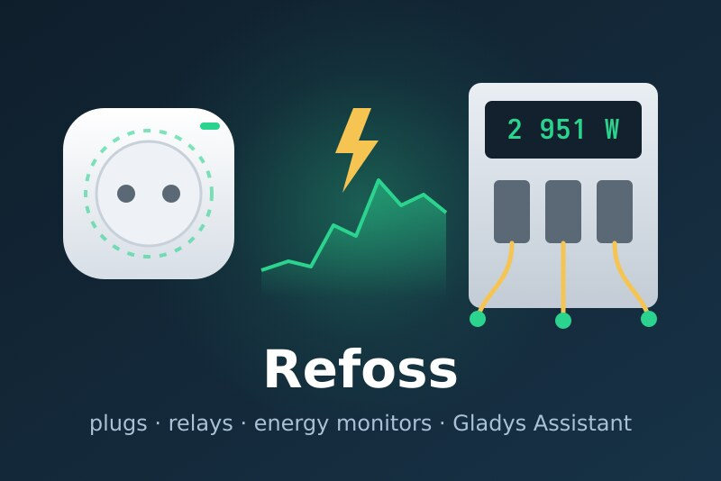
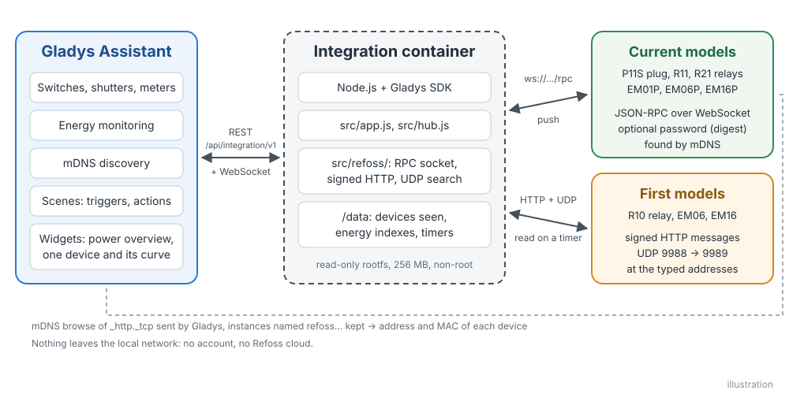
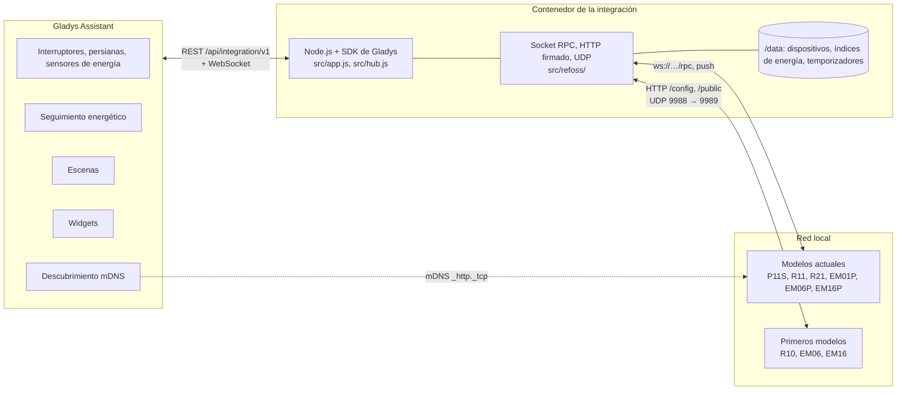
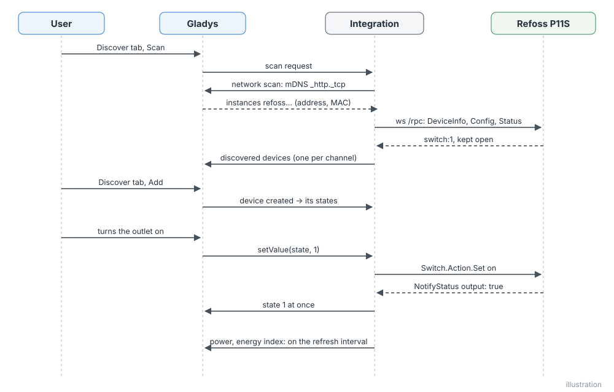
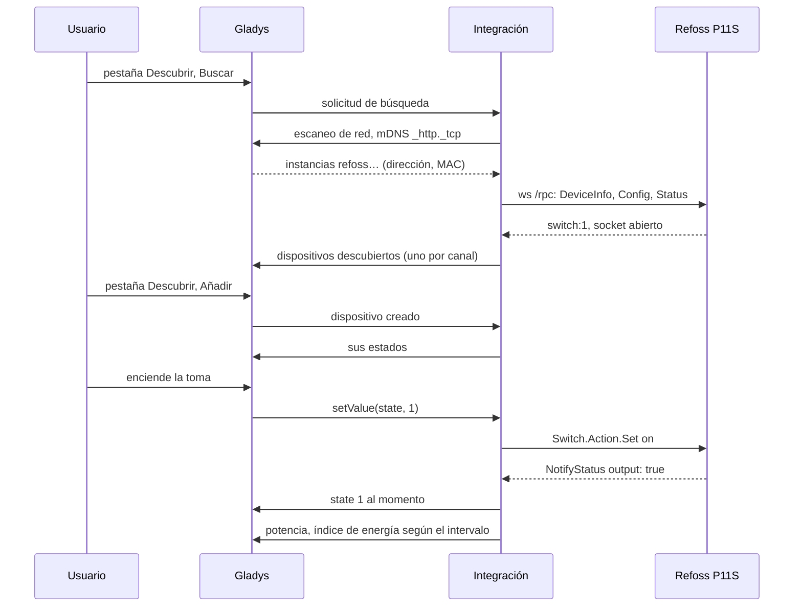
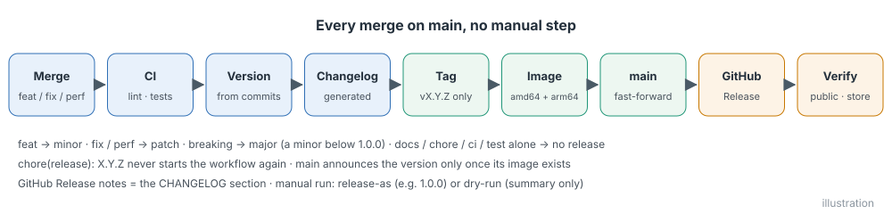

# Refoss para Gladys Assistant

[English](README.md) | [Français](README.fr.md) | [Deutsch](README.de.md) | **Español**

[](LICENSE)
[](https://github.com/William-De71/gladys-refoss/releases)
[](https://github.com/William-De71/gladys-refoss/actions/workflows/release.yml)
[](https://gladysassistant.com)



Tus enchufes inteligentes, relés, módulos de persiana y medidores de energía Refoss en Gladys Assistant, en tu red local y sin la nube de Refoss. Cada toma, persiana y pinza amperimétrica se convierte en un dispositivo de Gladys, con índices de energía listos para el seguimiento energético de Gladys, dos widgets, y las pulsaciones de botón y las protecciones como disparadores de escena. Integración no oficial, sin relación con Refoss.

## Funciones

- **Las dos generaciones de dispositivos Refoss**: los modelos actuales (enchufe P11S, relés R11 y R21, medidores de energía EM01P, EM06P y EM16P), que se encuentran solos gracias al descubrimiento mDNS de Gladys, y los primeros modelos (relé R10, medidores de energía EM06 y EM16), en las direcciones IP que tú indiques.
- **Un dispositivo por canal**: una toma o un relé (encendido / apagado, además de potencia, tensión, corriente y energía en los modelos que miden), un motor de persiana conectado a un R11 o R21 (abrir / parar / cerrar, y la posición una vez calibrado), una pinza de un medidor de energía (potencia, tensión, corriente, energía consumida y energía devuelta), con los nombres de la app Refoss.
- **Índices de energía para Gladys**: los contadores de los dispositivos se reinician cada mes; la integración los convierte en índices que solo suben, conservados tras los reinicios, que el seguimiento energético de Gladys puede sumar y valorar en euros.
- **Estados enviados al momento**: un modelo actual notifica cada cambio por su WebSocket local; el encendido / apagado y las persianas llegan a Gladys enseguida, y las medidas con un intervalo de actualización de 10, 30 o 60 segundos.
- **Dos widgets para el panel**: todas las tomas y pinzas de un vistazo, de la que más consume a la que menos; y un dispositivo con su potencia en directo, el consumo de hoy y del mes, y su curva de potencia de las últimas 24 horas.
- **Cuatro disparadores de escena** (se pulsa un botón conectado a la entrada de un dispositivo, salta una protección, se pierde un dispositivo, vuelve un dispositivo) y **dos acciones de escena** (encender una toma unos minutos, leer los contadores de energía).
- Admite la contraseña definida en la app Refoss. Todo se queda en la red local.
- En inglés, francés, alemán y español.

## Cómo funciona





**Modelos actuales.** Gladys, en la red del anfitrión, explora el servicio mDNS `_http._tcp` y transmite las respuestas; la integración se queda con las instancias llamadas `refoss<model>-<MAC>` (el filtro de la integración oficial de Refoss para Home Assistant). Después abre el WebSocket `ws://<address>/rpc` de cada dispositivo y llama a `Refoss.DeviceInfo.Get`, `Refoss.Config.Get` y `Refoss.Status.Get`; a partir de ahí, el dispositivo envía `NotifyStatus` (lo que ha cambiado) y `NotifyEvent` (pulsaciones de botón). Las órdenes son `Switch.Action.Set`, `Cover.Action.Set` y `Cover.Pos.Set`. Si el dispositivo tiene contraseña, responde 401 con un desafío y las llamadas llevan un resumen SHA-256 del usuario `admin` y de tu contraseña.

**Primeros modelos.** Responden a una búsqueda UDP (puerto 9988) en el puerto fijo 9989 del emisor, que el escaneo de red mediado de Gladys no puede oír: la integración consulta ella misma, desde su contenedor, las direcciones que has indicado. Después los lee por HTTP con mensajes firmados (`Appliance.Control.ToggleX`, `Appliance.Control.ElectricityX`), según el intervalo de actualización.





### Dispositivos y funciones

| Canal                                                | Dispositivo de Gladys                       | Funciones                                                                                                           |
| ---------------------------------------------------- | ------------------------------------------- | ------------------------------------------------------------------------------------------------------------------- |
| toma o relé (P11S, R11, R21, R10)                    | `switch`                                    | `state` (`binary`)                                                                                                  |
| … que mide (P11S, relés que informan de la potencia) | + `switch`, `energy-sensor`                 | `power` (W), `voltage` (V), `current` (A), `energy` (`index`, kWh)                                                  |
| motor de persiana (R11, R21 en modo persiana)        | `shutter`                                   | `state` (−1 cerrar, 0 parar, 1 abrir), `position` (% de apertura, una vez calibrado)                                |
| pinza (EM01P, EM06, EM06P, EM16, EM16P)              | `energy-sensor`, `energy-production-sensor` | `power` (W, por debajo de 0 cuando se devuelve energía), `voltage`, `current`, `energy` y `returned` (`index`, kWh) |

Identificadores externos: `ext:<selector>:switch:<MAC>-switch<n>`, `…:cover:<MAC>-cover<n>`, `…:meter:<MAC>-em<n>`; funciones `…:state`, `…:position`, `…:power`, `…:voltage`, `…:current`, `…:energy`, `…:returned`. Las pinzas conservan los nombres de la app Refoss; si no, llevan el nombre de la caja y de la pinza (`A1`, `B1`…).

**Índices de energía.** Gladys necesita un índice de contador que nunca baje. La integración sigue el contador total cuando el firmware lo tiene y, si no, el contador del mes, y suma lo que aumenta: una pequeña bajada se ignora, y una bajada grande solo cuenta como reinicio (un mes nuevo) si dura un minuto (un dispositivo que marca 0 unos segundos tras reiniciarse no cambia nada). Los índices se guardan en `/data/energy.json`.

## Transporte

`transports: ["local"]`: el catálogo muestra la etiqueta **local**. Nada sale de la red local: ni cuenta Refoss ni nube. Cada dispositivo publica **local** mientras su caja responde y **unreachable** en caso contrario; no hay preferencia local que elegir ni modo degradado.

## Widgets


- **Dispositivo Refoss** (`device`, ajuste: una toma, pinza o persiana): potencia en directo, energía de hoy y de este mes (los contadores del dispositivo, para los que Gladys no tiene función), energía devuelta este mes en el caso de una pinza, la curva de potencia de las últimas 24 horas, el estado y las protecciones, y los botones **Encender / Apagar** o **Abrir / Parar / Cerrar**.
- **Potencia Refoss** (`power`): todas las tomas, pinzas y persianas añadidas a Gladys (ocho como máximo), de la que más consume a la que menos, con su potencia en directo, su energía del mes (o lo que ha devuelto una pinza solar) y su estado, además de las cajas que no responden o piden contraseña.

## Disparadores y acciones de escena

Disparadores:

- `button_pressed` — **Se pulsa un botón de un dispositivo Refoss**: un pulsador conectado a la entrada de un R11, R21 o P11S, configurado como botón en la app Refoss. Filtros: dispositivo, `click` (`single`, `double`, `triple`, `long`). Variables: `device_name`, `button` (número de entrada).
- `protection_tripped` — **Salta una protección Refoss**: el dispositivo ha cortado la corriente o avisa. Filtros: dispositivo, `protection` (`overpower`, `overvoltage`, `overcurrent`, `undervoltage`, `overtemp`). Variable: `device_name`. Un evento cuando aparece la protección.
- `device_offline` — **Se pierde un dispositivo Refoss** (sin respuesta durante un minuto). Variables: `device_name`, `model`, `address`.
- `device_online` — **Vuelve un dispositivo Refoss** (tras un evento de desconexión).

Acciones:

- `switch_on_for` — **Encender un enchufe Refoss un rato**: `device`, `minutes` (de 1 a 1 440). Se enciende ya y se apaga al cabo de ese tiempo, aunque la integración se reinicie entretanto; si se vuelve a ejecutar, la cuenta empieza de nuevo. Salida: `off_at` (fecha ISO).
- `read_energy` — **Leer la energía de un dispositivo Refoss**: salidas `power_w`, `today_kwh`, `week_kwh`, `month_kwh`, `month_returned_kwh`, `index_kwh` (null cuando el modelo no lo cuenta).

Ejemplos:

- **Se pulsa un botón de un dispositivo Refoss**, relé del pasillo, `double` → apagar todas las luces de la casa.
- **Salta una protección Refoss**, `overpower` → enviar la notificación «El horno ha hecho saltar su enchufe».
- Todas las noches a las 21:00 → **Leer la energía** de la pinza de la bomba de calor y enviar «Bomba de calor hoy: {{today_kwh}} kWh».

## Requisitos

- Gladys Assistant **5.3.0 o posterior** (widgets de panel y disparadores y acciones de escena de las integraciones, el catálogo de palabras clave/países de Gladys 5.3; las instancias más antiguas no pueden instalar la integración).
- Dispositivos Refoss configurados en la app Refoss, en la misma red que Gladys. Los primeros modelos (R10, EM06, EM16) necesitan una dirección IP fija (una reserva DHCP en tu router).

## Instalación

- **Desde la tienda**: Integraciones → buscar «Refoss» → Instalar. Acepta el descubrimiento de red (mDNS) en la pantalla de instalación.
- **Desde la URL del repositorio**: Integraciones → Instalar una integración → pega `https://github.com/William-De71/gladys-refoss`.
- **Modo desarrollador**: Integraciones → Instalar una integración → Modo desarrollador, con el manifiesto de una compilación (lo muestra el resumen del workflow «Build and publish image»).

## Configuración

| Campo              | Tipo   | Por defecto | Significado                                                                                         |
| ------------------ | ------ | ----------- | --------------------------------------------------------------------------------------------------- |
| `hosts`            | string | vacío       | direcciones IP de los R10, EM06 y EM16 (y de modelos actuales en otra subred), separadas por comas  |
| `password`         | secret | vacío       | la contraseña definida en la app Refoss, si la hay (la misma para todos los dispositivos)           |
| `refresh_interval` | select | `30`        | segundos entre dos medidas enviadas a Gladys (y entre dos lecturas de un primer modelo): 10, 30, 60 |
| `rescan_interval`  | select | `60`        | búsqueda automática en minutos: `0` (desactivada), `15`, `60`                                       |
| `language`         | select | `en`        | idioma de los nombres de las funciones y de los errores de escena                                   |

En la página de configuración, los campos se llaman **Direcciones de los modelos antiguos**, **Contraseña de los dispositivos**, **Actualización de las medidas**, **Volver a buscar** e **Idioma de los nombres de dispositivos**. Botón de la página de configuración: **Buscar los dispositivos** (busca en la red y en las direcciones, y lista cada dispositivo con su dirección, modelo, firmware y canales).

## Uso

1. Instala la integración, escribe las direcciones de tus R10, EM06 o EM16 si tienes alguno y pulsa **Buscar los dispositivos**.
2. Añade las tomas, persianas y pinzas desde la **pestaña Descubrir**.
3. Incluye las pinzas y las tomas en el seguimiento energético de Gladys, añade los widgets a un panel y crea tus escenas.

La documentación de usuario está en [docs/es.md](docs/es.md) ([en](docs/en.md), [fr](docs/fr.md), [de](docs/de.md)).

## Limitaciones

- **Nunca probada con un dispositivo real**: todo se prueba con dispositivos simulados (servidores WebSocket, HTTP y UDP locales reales) que siguen el código oficial de Refoss. Se agradecen los comentarios.
- Los primeros modelos no se encuentran solos: hay que escribir sus direcciones.
- Un índice de energía empieza en el contador del mes (o en el contador total) el día en que se añade el dispositivo: lo consumido antes no está en Gladys.
- No se gestionan: las actualizaciones de firmware, los ajustes Wi-Fi, los «canales fusionados» de los medidores EM, la configuración de las entradas, los temporizadores y programaciones de la app Refoss ni la nube de Refoss.
- El factor de potencia, la temperatura del dispositivo y la señal Wi-Fi se leen, pero no se publican como funciones.

## Desarrollo local

```bash
npm install
GLADYS_HOST_API_URL=http://localhost:1443 \
  GLADYS_INTEGRATION_TOKEN=… GLADYS_INTEGRATION_SELECTOR=… \
  REFOSS_DATA_DIR=./data DEBUG=gladys-integration-sdk node index.js
```

| Variable                                                                         | Por defecto         | Uso                                                     |
| -------------------------------------------------------------------------------- | ------------------- | ------------------------------------------------------- |
| `GLADYS_HOST_API_URL`, `GLADYS_INTEGRATION_TOKEN`, `GLADYS_INTEGRATION_SELECTOR` | definido por Gladys | conexión con la API del anfitrión de Gladys             |
| `REFOSS_DATA_DIR`                                                                | `/data`             | carpeta de `devices.json`, `energy.json`, `timers.json` |
| `DEBUG`                                                                          | sin definir         | `gladys-integration-sdk` para los registros del SDK     |

| Script                            | Qué hace                                     |
| --------------------------------- | -------------------------------------------- |
| `npm test`                        | las pruebas (`node --test`), sin red         |
| `npm run lint`                    | ESLint                                       |
| `npm run format` / `format:check` | Prettier                                     |
| `docs/illustrations/render.sh`    | regenera las ilustraciones de los widgets    |
| `scripts/build-cover.sh`          | regenera `cover.jpg` a partir de `cover.svg` |

## Pruebas

`npm test` ejecuta toda la integración contra el Gladys simulado del SDK y dispositivos Refoss simulados sobre sockets locales reales: dispositivos RPC (HTTP + WebSocket `/rpc`, `NotifyStatus` y `NotifyEvent`, autenticación digest) y dispositivos de primera generación (mensajes HTTP firmados, búsqueda UDP respondida al puerto fijo). Se cubre: el descubrimiento por mDNS, por dirección y por UDP, las conversiones de unidades, los índices de energía (fluctuaciones, reinicios, meses nuevos, rearranques), todas las órdenes, la contraseña (ausente, incorrecta, corregida), los disparadores y acciones de escena, los dos widgets validados por `validateWidgetContent`, y los dispositivos que se pierden y vuelven. Los dispositivos se comprueban frente a las reglas del núcleo de Gladys y una referencia de descubrimiento (los identificadores externos son para siempre), y el manifiesto frente al código, las traducciones y el script de publicación. La CI también construye la imagen y la arranca como lo hace Gladys (solo lectura, 256 MB, sin red).

## Proceso de publicación

Cada fusión en `main` publica una versión cuando sus commits lo justifican, sin ningún paso manual:

```mermaid
flowchart LR
  A[fusión en main] --> B[CI: Prettier, ESLint,<br/>pruebas, build Docker]
  B --> C[siguiente versión según<br/>Conventional Commits]
  C --> D[sección de CHANGELOG.md]
  D --> E[commit chore release<br/>+ tag vX.Y.Z]
  E --> F[imagen :X.Y.Z + :latest<br/>amd64 + arm64]
  F --> G[main avanza hasta<br/>el commit de publicación]
  G --> H[GitHub Release]
  H --> I[verificación: pull anónimo,<br/>validador de la tienda, topic]
```





- `feat` → menor, `fix` / `perf` → parche, `!` o `BREAKING CHANGE:` → mayor (una menor por debajo de 1.0.0). `docs`, `chore`, `ci`, `test`, `style`, `refactor` y `build` por sí solos no publican nada.
- El título de la pull request se convierte en el commit de squash y, por tanto, en la línea del changelog: escríbelo en inglés, pensando en el usuario (`feat(widgets): …`). `pr-title.yml` lo comprueba. No edites nunca `CHANGELOG.md` a mano.
- La imagen existe antes de que `main` anuncie su versión (la tienda indexa `main`).
- La 1.0.0 es una decisión manual: Actions → Release → Run workflow, `release-as: 1.0.0`. `dry-run` muestra la versión y el changelog sin publicar.
- **`main` protegida**: la publicación envía un commit a `main`. Si una protección de rama o un ruleset exige pull requests o comprobaciones de estado, permite que GitHub Actions la omita (o usa una GitHub App); si no, la publicación se detiene después de la imagen.
- Tras la primera publicación, haz público el paquete si hace falta: Package settings → Change visibility → Public.

## Solución de problemas

- **No se encuentra un modelo actual**: comprueba que la app Refoss llega a él en la misma Wi-Fi, que tu red deja pasar el mDNS (algunos sistemas mesh y redes de invitados no lo hacen) o escribe su dirección.
- **No se encuentra un R10, EM06 o EM16**: escribe su dirección y comprueba que nada más en el ordenador de Gladys usa el puerto UDP 9989.
- **«protegido con contraseña»**: escribe la contraseña de la app Refoss en la configuración.
- **La energía de una pinza parece incorrecta**: comprueba el sentido de la pinza (lleva una flecha); una pinza colocada al revés cuenta la energía como devuelta.
- **«Gladys rechazó la búsqueda en la red»**: reinstala la integración y acepta su descubrimiento de red en la pantalla de instalación.
- Registros: la pestaña Registros de la integración; `DEBUG=gladys-integration-sdk` para los detalles del SDK.

## Contribuir

Las incidencias y las pull requests son bienvenidas. Ejecuta `npm run format:check`, `npm run lint` y `npm test`, escribe el título de la pull request como un Conventional Commit y ejecuta `docs/illustrations/render.sh` tras cualquier cambio en el contenido de un widget. Una función nueva no debe cambiar las existentes (`test/fixtures/discovery.baseline.json`). Cuando un dispositivo real se comporte de otra manera, corrige primero los dispositivos simulados de `test/helpers/` y después el código.

## Seguridad

Consulta [SECURITY.md](SECURITY.md). El único secreto es la contraseña de los dispositivos de la configuración, que Gladys guarda y que nunca se escribe en los registros. `/data` conserva la dirección MAC, la dirección IP, el modelo y el uuid de cada dispositivo detectado, los índices de energía y los temporizadores de «encender un rato». Los primeros modelos no tienen autenticación, y los actuales tampoco sin contraseña: mantenlos en una red de confianza y nunca expuestos a Internet.

## Licencia

[Apache License 2.0](LICENSE); consulta también [NOTICE](NOTICE). Los clientes se escribieron para este proyecto a partir del código oficial de Refoss (aiorefoss, refoss_rpc, refoss_ha, ioBroker.refoss, MIT) y de la integración de Home Assistant; no se ha copiado código. Refoss es una marca de su propietario; este proyecto no está afiliado, respaldado ni apoyado por Refoss.
