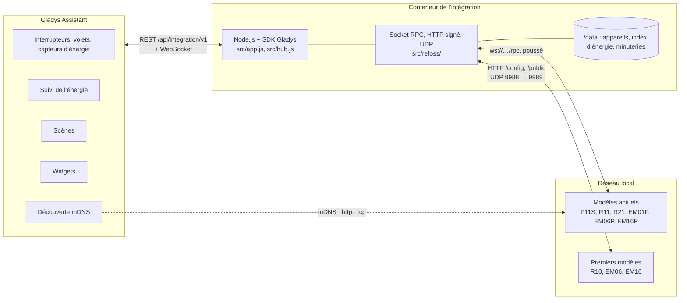
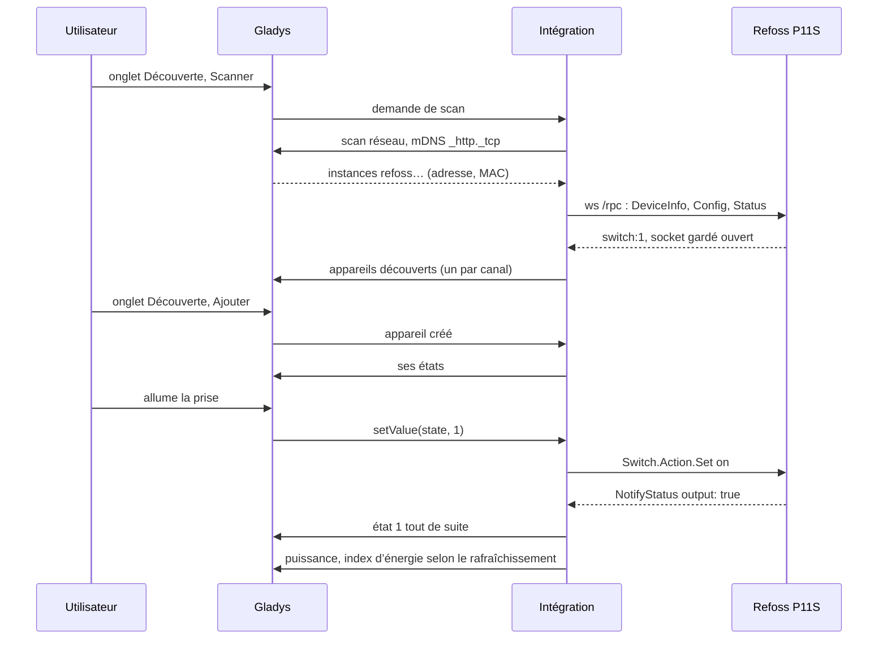

# Refoss pour Gladys Assistant

[English](README.md) | **Français** | [Deutsch](README.de.md) | [Español](README.es.md)

[](LICENSE)
[](https://github.com/William-De71/gladys-refoss/releases)
[](https://github.com/William-De71/gladys-refoss/actions/workflows/release.yml)
[](https://gladysassistant.com)


Vos prises connectées, relais, modules de volet et compteurs d’énergie Refoss dans Gladys Assistant, sur votre réseau local, sans le cloud Refoss. Chaque prise, volet et pince ampèremétrique devient un appareil Gladys, avec des index d’énergie prêts pour le suivi de l’énergie de Gladys, deux widgets, les appuis de boutons et les protections en déclencheurs de scène. Non officiel, sans lien avec Refoss.

## Fonctionnalités

- **Les deux générations d’appareils Refoss** : les modèles actuels (prise P11S, relais R11 et R21, compteurs d’énergie EM01P, EM06P et EM16P) trouvés tout seuls par la découverte mDNS de Gladys, et les premiers modèles (relais R10, compteurs d’énergie EM06 et EM16) aux adresses IP que vous saisissez.
- **Un appareil par canal** : une prise ou un relais (marche / arrêt, plus puissance, tension, intensité et énergie sur les modèles qui mesurent), un moteur de volet câblé sur un R11 ou un R21 (ouvrir / arrêter / fermer, position une fois calibré), une pince d’un compteur d’énergie (puissance, tension, intensité, énergie consommée et énergie renvoyée), nommés comme dans l’application Refoss.
- **Des index d’énergie pour Gladys** : les compteurs des appareils repartent de zéro chaque mois ; l’intégration en fait des index qui ne font que monter, conservés d’un redémarrage à l’autre, que le suivi de l’énergie de Gladys sait additionner et chiffrer.
- **États poussés** : un modèle actuel signale chaque changement sur son WebSocket local ; marche / arrêt et volets arrivent tout de suite dans Gladys, les mesures selon un rafraîchissement de 10, 30 ou 60 secondes.
- **Deux widgets de tableau de bord** : chaque prise et pince d’un coup d’œil, la plus gourmande en premier ; un appareil avec sa puissance en direct, aujourd’hui, ce mois-ci et sa courbe de puissance des dernières 24 heures.
- **Quatre déclencheurs de scène** (un bouton sur l’entrée d’un appareil est appuyé, une protection se déclenche, un appareil est perdu, un appareil est de retour) et **deux actions de scène** (allumer une prise quelques minutes, lire les compteurs d’énergie).
- Le mot de passe défini dans l’application Refoss est pris en charge. Tout reste sur le réseau local.
- Anglais, français, allemand et espagnol.

## Fonctionnement




**Modèles actuels.** Gladys, sur le réseau de l’hôte, parcourt le service mDNS `_http._tcp` et relaie les réponses ; l’intégration garde les instances nommées `refoss<modèle>-<MAC>` (le filtre de l’intégration Refoss officielle pour Home Assistant). Elle ouvre ensuite le WebSocket `ws://<adresse>/rpc` de chaque appareil et appelle `Refoss.DeviceInfo.Get`, `Refoss.Config.Get` et `Refoss.Status.Get` ; dès lors l’appareil pousse `NotifyStatus` (ce qui a changé) et `NotifyEvent` (les appuis de bouton). Les commandes sont `Switch.Action.Set`, `Cover.Action.Set` et `Cover.Pos.Set`. Quand l’appareil a un mot de passe, il répond 401 avec un défi et les appels portent un condensé SHA-256 de l’utilisateur `admin` et de votre mot de passe.

**Premiers modèles.** Ils répondent à une recherche UDP (port 9988) vers le port fixe 9989 de l’émetteur, que le scan réseau relayé par Gladys ne peut pas entendre : l’intégration interroge elle-même, depuis son conteneur, les adresses que vous avez saisies. Ils sont ensuite lus en HTTP avec des messages signés (`Appliance.Control.ToggleX`, `Appliance.Control.ElectricityX`), selon le rafraîchissement choisi.




### Appareils et fonctionnalités

| Canal                                                   | Appareil Gladys                             | Fonctionnalités                                                                                       |
| ------------------------------------------------------- | ------------------------------------------- | ----------------------------------------------------------------------------------------------------- |
| prise ou relais (P11S, R11, R21, R10)                   | `switch`                                    | `state` (`binary`)                                                                                    |
| … qui mesure (P11S, relais qui rapportent la puissance) | + `switch`, `energy-sensor`                 | `power` (W), `voltage` (V), `current` (A), `energy` (`index`, kWh)                                    |
| moteur de volet (R11, R21 en mode volet)                | `shutter`                                   | `state` (−1 fermer, 0 arrêter, 1 ouvrir), `position` (% d’ouverture, une fois calibré)                |
| pince (EM01P, EM06, EM06P, EM16, EM16P)                 | `energy-sensor`, `energy-production-sensor` | `power` (W, négative quand elle renvoie), `voltage`, `current`, `energy` et `returned` (`index`, kWh) |

Identifiants externes : `ext:<sélecteur>:switch:<MAC>-switch<n>`, `…:cover:<MAC>-cover<n>`, `…:meter:<MAC>-em<n>` ; fonctionnalités `…:state`, `…:position`, `…:power`, `…:voltage`, `…:current`, `…:energy`, `…:returned`. Les pinces gardent les noms de l’application Refoss, sinon le nom du boîtier et de la pince (`A1`, `B1`…).

**Index d’énergie.** Gladys a besoin d’un index de compteur qui ne baisse jamais. L’intégration suit le compteur à vie quand le micrologiciel en a un, sinon le compteur du mois, et ajoute ce qu’il gagne : une petite baisse est ignorée, une forte baisse ne compte comme une remise à zéro (un nouveau mois) que si elle dure une minute (un appareil qui lit 0 quelques secondes après un redémarrage ne change rien). Les index sont gardés dans `/data/energy.json`.

## Transport

`transports: ["local"]` : le catalogue affiche le badge **local**. Rien ne sort du réseau local : pas de compte Refoss, pas de cloud. Chaque appareil publie **local** tant que son boîtier répond et **injoignable** sinon ; il n’y a ni préférence locale à choisir, ni mode dégradé.

## Widgets


- **Appareil Refoss** (`device`, réglage : une prise, une pince ou un volet) : puissance en direct, énergie d’aujourd’hui et du mois (les compteurs de l’appareil, pour lesquels Gladys n’a pas de fonctionnalité), énergie renvoyée ce mois-ci pour une pince, courbe de puissance des dernières 24 heures, état et protections, et les boutons **Allumer / Éteindre** ou **Ouvrir / Stop / Fermer**.
- **Puissance Refoss** (`power`) : chaque prise, pince et volet ajouté à Gladys (huit au plus), le plus gourmand en premier, avec sa puissance en direct, son énergie du mois (ou ce qu’une pince solaire a renvoyé) et son état, et les boîtiers qui ne répondent pas ou demandent un mot de passe.

## Déclencheurs et actions de scène

Déclencheurs :

- `button_pressed` — **Un bouton d’un appareil Refoss est appuyé** : un bouton poussoir câblé sur l’entrée d’un R11, R21 ou P11S, réglée en bouton dans l’application Refoss. Filtres : appareil, `click` (`single`, `double`, `triple`, `long`). Variables : `device_name`, `button` (numéro d’entrée).
- `protection_tripped` — **Une protection Refoss se déclenche** : l’appareil a coupé ou alerte. Filtres : appareil, `protection` (`overpower`, `overvoltage`, `overcurrent`, `undervoltage`, `overtemp`). Variable : `device_name`. Un événement quand la protection apparaît.
- `device_offline` — **Un appareil Refoss est perdu** (pas de réponse depuis une minute). Variables : `device_name`, `model`, `address`.
- `device_online` — **Un appareil Refoss est de retour** (après un événement de perte).

Actions :

- `switch_on_for` — **Allumer une prise Refoss un moment** : `device`, `minutes` (1 à 1 440). Allumée tout de suite, éteinte après la durée, même si l’intégration redémarre entre-temps ; relancée, la durée repart de zéro. Sortie : `off_at` (date ISO).
- `read_energy` — **Lire l’énergie d’un appareil Refoss** : sorties `power_w`, `today_kwh`, `week_kwh`, `month_kwh`, `month_returned_kwh`, `index_kwh` (null quand le modèle ne les compte pas).

Exemples :

- **Un bouton d’un appareil Refoss est appuyé**, relais de l’entrée, `double` → éteindre toutes les lumières de la maison.
- **Une protection Refoss se déclenche**, `overpower` → envoyer une notification « Le four a fait disjoncter sa prise ».
- Chaque soir à 21 h → **Lire l’énergie** de la pince de la pompe à chaleur, puis envoyer « Pompe à chaleur aujourd’hui : {{today_kwh}} kWh ».

## Prérequis

- Gladys Assistant **5.1.0 ou plus récent** (widgets de tableau de bord, déclencheurs et actions de scène des intégrations ; les instances plus anciennes ne peuvent pas installer l’intégration).
- Des appareils Refoss installés avec l’application Refoss, sur le même réseau que Gladys. Les premiers modèles (R10, EM06, EM16) ont besoin d’une adresse IP fixe (réservation DHCP dans votre box).

## Installation

- **Depuis le store** : Intégrations → chercher « Refoss » → Installer. Acceptez la découverte réseau (mDNS) sur l’écran d’installation.
- **Depuis l’URL du dépôt** : Intégrations → Installer une intégration → coller `https://github.com/William-De71/gladys-refoss`.
- **Mode développeur** : Intégrations → Installer une intégration → Mode développeur, avec le manifeste d’un build (le résumé du workflow « Build and publish image » l’affiche).

## Configuration

| Champ              | Type   | Défaut | Rôle                                                                                                         |
| ------------------ | ------ | ------ | ------------------------------------------------------------------------------------------------------------ |
| `hosts`            | string | vide   | adresses IP des R10, EM06 et EM16 (et des modèles actuels d’un autre sous-réseau), séparées par des virgules |
| `password`         | secret | vide   | le mot de passe défini dans l’application Refoss, s’il y en a un (le même pour tous les appareils)           |
| `refresh_interval` | select | `30`   | secondes entre deux mesures envoyées à Gladys (et deux lectures d’un premier modèle) : 10, 30, 60            |
| `rescan_interval`  | select | `60`   | recherche automatique en minutes : `0` (désactivée), `15`, `60`                                              |
| `language`         | select | `en`   | langue des noms de fonctionnalités et des erreurs de scène                                                   |

Bouton de la page de configuration : **Rechercher les appareils** (fouille le réseau et les adresses, liste chaque appareil avec son adresse, son modèle, son micrologiciel et ses canaux).

## Utilisation

1. Installez l’intégration, saisissez les adresses de vos R10, EM06 ou EM16 si vous en avez, puis appuyez sur **Rechercher les appareils**.
2. Ajoutez les prises, volets et pinces depuis l’onglet **Découverte**.
3. Placez les pinces et les prises dans le suivi de l’énergie de Gladys, ajoutez les widgets à un tableau de bord, créez vos scènes.

La documentation utilisateur est dans [docs/fr.md](docs/fr.md) ([en](docs/en.md), [de](docs/de.md), [es](docs/es.md)).

## Limites

- **Jamais testée sur un vrai appareil** : tout est testé contre des appareils simulés (vrais serveurs WebSocket, HTTP et UDP locaux) qui suivent le code officiel de Refoss. Vos retours sont les bienvenus.
- Les premiers modèles ne sont pas trouvés tout seuls : il faut saisir leurs adresses.
- Un index d’énergie démarre au compteur du mois (ou au compteur à vie) le jour où l’appareil est ajouté : ce qui a été consommé avant n’est pas dans Gladys.
- Non gérés : mises à jour du micrologiciel, réglages Wi-Fi, « canaux fusionnés » des compteurs EM, configuration des entrées, minuteries et programmations de l’application Refoss, cloud Refoss.
- Le facteur de puissance, la température de l’appareil et le signal Wi-Fi sont lus mais pas publiés en fonctionnalités.

## Développement local

```bash
npm install
GLADYS_HOST_API_URL=http://localhost:1443 \
  GLADYS_INTEGRATION_TOKEN=… GLADYS_INTEGRATION_SELECTOR=… \
  REFOSS_DATA_DIR=./data DEBUG=gladys-integration-sdk node index.js
```

| Variable                                                                         | Défaut              | Usage                                                   |
| -------------------------------------------------------------------------------- | ------------------- | ------------------------------------------------------- |
| `GLADYS_HOST_API_URL`, `GLADYS_INTEGRATION_TOKEN`, `GLADYS_INTEGRATION_SELECTOR` | fournies par Gladys | connexion à l’API hôte de Gladys                        |
| `REFOSS_DATA_DIR`                                                                | `/data`             | dossier de `devices.json`, `energy.json`, `timers.json` |
| `DEBUG`                                                                          | non défini          | `gladys-integration-sdk` pour les logs du SDK           |

| Script                            | Rôle                                    |
| --------------------------------- | --------------------------------------- |
| `npm test`                        | les tests (`node --test`), sans réseau  |
| `npm run lint`                    | ESLint                                  |
| `npm run format` / `format:check` | Prettier                                |
| `docs/illustrations/render.sh`    | régénère les illustrations des widgets  |
| `scripts/build-cover.sh`          | régénère `cover.jpg` depuis `cover.svg` |

## Tests

`npm test` fait tourner toute l’intégration contre le faux Gladys du SDK et de faux appareils Refoss sur de vrais sockets locaux : appareils RPC (HTTP + WebSocket `/rpc`, `NotifyStatus` et `NotifyEvent`, authentification par condensé) et appareils de première génération (messages HTTP signés, recherche UDP avec réponse vers le port fixe). Couverts : découverte par mDNS, par adresse et en UDP, conversions d’unités, index d’énergie (fluctuations, redémarrages, nouveaux mois, relances), chaque commande, le mot de passe (absent, faux, corrigé), déclencheurs et actions de scène, les deux widgets validés par `validateWidgetContent`, appareils perdus et retrouvés. Les appareils sont vérifiés contre les règles du cœur de Gladys et une référence de découverte (les identifiants externes sont éternels), le manifeste contre le code, ainsi que les traductions et le script de release. La CI construit aussi l’image et la démarre comme Gladys (lecture seule, 256 Mo, sans réseau).

## Processus de release

Chaque fusion sur `main` publie une release quand ses commits le justifient, sans étape manuelle :

```mermaid
flowchart LR
  A[fusion sur main] --> B[CI : Prettier, ESLint,<br/>tests, build Docker]
  B --> C[version suivante d’après<br/>les Conventional Commits]
  C --> D[section du CHANGELOG.md]
  D --> E[commit chore release<br/>+ tag vX.Y.Z]
  E --> F[image :X.Y.Z + :latest<br/>amd64 + arm64]
  F --> G[main avance sur<br/>le commit de release]
  G --> H[GitHub Release]
  H --> I[vérification : pull anonyme,<br/>validateur du store, topic]
```




- `feat` → mineure, `fix` / `perf` → correctif, `!` ou `BREAKING CHANGE:` → majeure (une mineure tant qu’on est sous 1.0.0). `docs`, `chore`, `ci`, `test`, `style`, `refactor`, `build` seuls ne publient rien.
- Le titre de la pull request devient le commit squash, donc la ligne du changelog : écrivez-le en anglais, pour l’utilisateur (`feat(widgets): …`). `pr-title.yml` le vérifie. Ne modifiez jamais `CHANGELOG.md` à la main.
- L’image existe avant que `main` n’annonce sa version (le store indexe `main`).
- 1.0.0 est une décision manuelle : Actions → Release → Run workflow, `release-as: 1.0.0`. `dry-run` montre la version et le changelog sans rien publier.
- **`main` protégée** : la release pousse un commit sur `main`. Avec une protection de branche ou un ruleset qui exige des pull requests ou des status checks, autorisez GitHub Actions à le contourner (ou utilisez une GitHub App), sinon la release s’arrête après l’image.
- Après la première release, rendez le package public si besoin : Package settings → Change visibility → Public.

## Dépannage

- **Un modèle actuel n’est pas trouvé** : vérifiez que l’application Refoss le joint sur le même Wi-Fi, que votre réseau laisse passer le mDNS (certains systèmes mesh et réseaux invités le bloquent), ou saisissez son adresse.
- **Un R10, EM06 ou EM16 n’est pas trouvé** : saisissez son adresse, et vérifiez que rien d’autre n’utilise le port UDP 9989 sur la machine de Gladys.
- **« protégé par un mot de passe »** : saisissez le mot de passe de l’application Refoss dans la configuration.
- **L’énergie d’une pince semble fausse** : vérifiez le sens de la pince (une flèche dessus) ; une pince posée à l’envers compte l’énergie comme renvoyée.
- **« Gladys a refusé la recherche réseau »** : réinstallez l’intégration en acceptant sa découverte réseau sur l’écran d’installation.
- Logs : l’onglet Logs de l’intégration ; `DEBUG=gladys-integration-sdk` pour le détail du SDK.

## Contribuer

Issues et pull requests bienvenues. Lancez `npm run format:check`, `npm run lint` et `npm test`, écrivez le titre de la pull request en Conventional Commit, et relancez `docs/illustrations/render.sh` après tout changement d’un contenu de widget. Une nouvelle fonctionnalité ne doit pas modifier les existantes (`test/fixtures/discovery.baseline.json`). Quand un vrai appareil se comporte autrement, corrigez d’abord les faux appareils de `test/helpers/`, puis le code.

## Sécurité

Voir [SECURITY.md](SECURITY.md). Le seul secret est le mot de passe des appareils de la configuration, stocké par Gladys et jamais écrit dans les logs. `/data` garde l’adresse MAC, l’adresse IP, le modèle et l’uuid de chaque appareil vu, les index d’énergie et les minuteries « allumer un moment ». Les premiers modèles n’ont aucune authentification, les actuels aucune sans mot de passe : gardez-les sur un réseau de confiance, jamais exposés à Internet.

## Licence

[Licence Apache 2.0](LICENSE), voir aussi [NOTICE](NOTICE). Les clients ont été écrits pour ce projet d’après le code officiel de Refoss (aiorefoss, refoss_rpc, refoss_ha, ioBroker.refoss, MIT) et l’intégration Home Assistant ; aucun code n’a été copié. Refoss est une marque de son propriétaire ; ce projet n’est ni affilié à Refoss, ni approuvé ou soutenu par Refoss.
