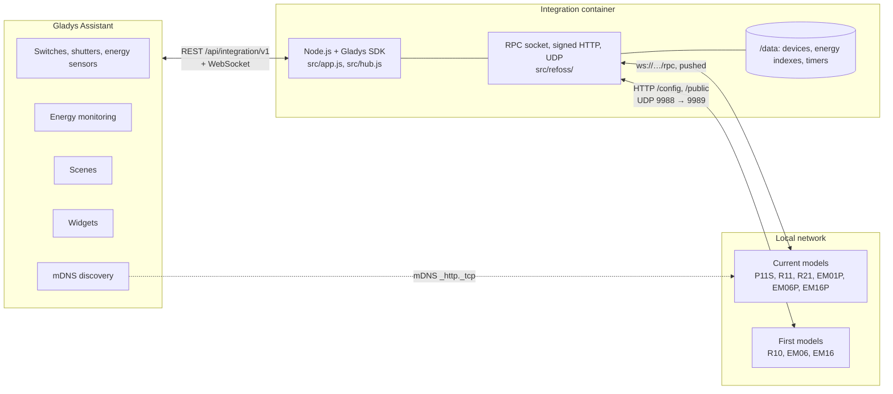
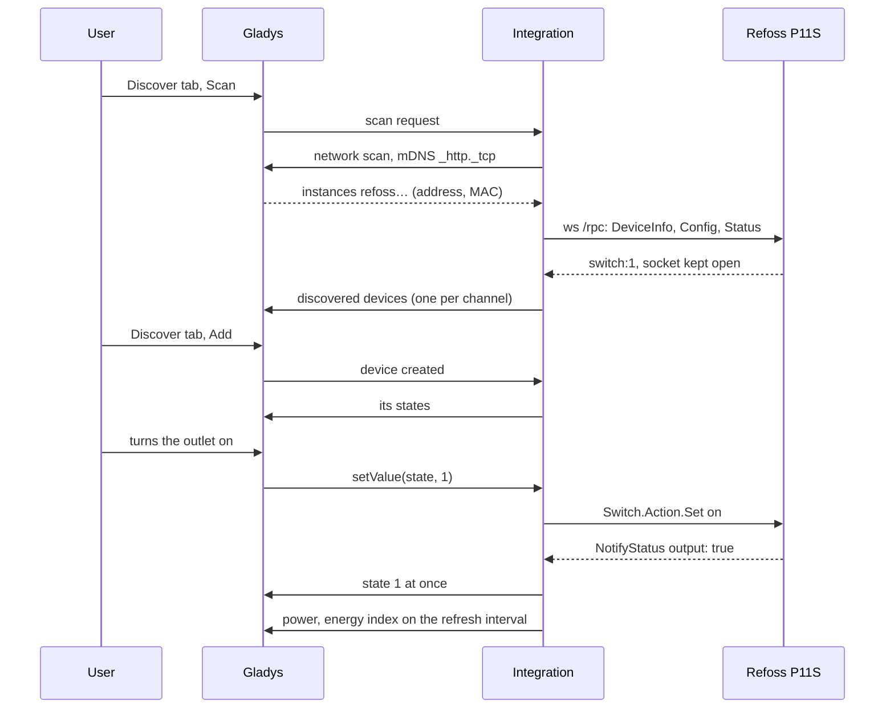
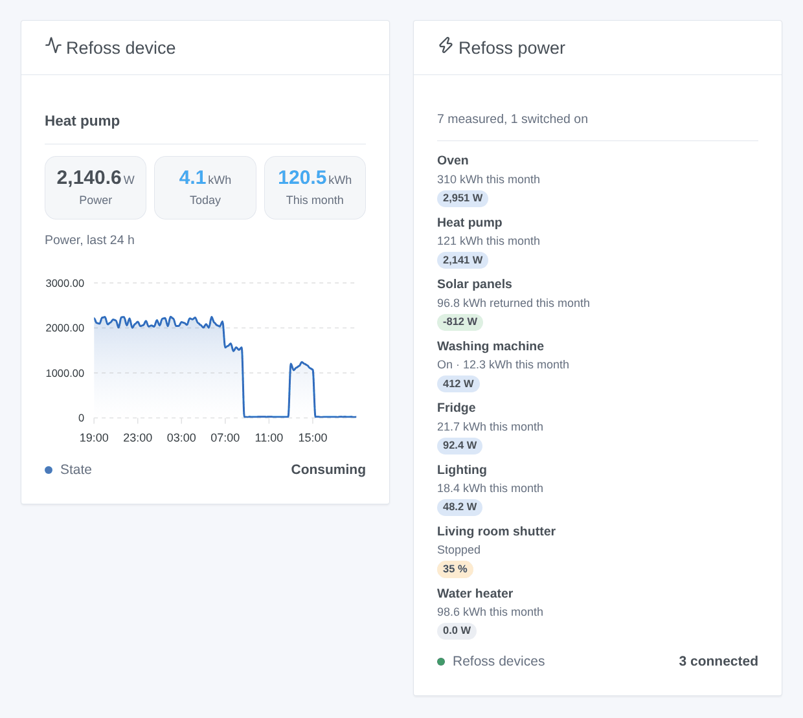

# Refoss for Gladys Assistant

**English** | [Français](README.fr.md) | [Deutsch](README.de.md) | [Español](README.es.md)

[](LICENSE)
[](https://github.com/William-De71/gladys-refoss/releases)
[](https://github.com/William-De71/gladys-refoss/actions/workflows/release.yml)
[](https://gladysassistant.com)


Your Refoss smart plugs, relays, shutter modules and energy monitors in Gladys Assistant, on your local network, without the Refoss cloud. Every outlet, shutter and current clamp becomes a Gladys device, with energy indexes ready for the energy monitoring of Gladys, two widgets, button presses and protections as scene triggers. Unofficial, not affiliated with Refoss.

## Features

- **Both generations of Refoss devices**: the current models (P11S plug, R11 and R21 relays, EM01P, EM06P and EM16P energy monitors) found by themselves through the mDNS discovery of Gladys, and the first models (R10 relay, EM06 and EM16 energy monitors) at the IP addresses you type.
- **One device per channel**: an outlet or a relay (on / off, plus power, voltage, current and energy on the models that measure), a shutter motor wired on an R11 or R21 (open / stop / close, position once calibrated), a current clamp of an energy monitor (power, voltage, current, energy consumed and energy returned), named as in the Refoss app.
- **Energy indexes for Gladys**: the counters of the devices restart every month; the integration turns them into indexes that only go up, kept across restarts, which the Gladys energy monitoring can add up and price.
- **Pushed states**: a current model notifies every change over its local WebSocket; on / off and shutters reach Gladys at once, measurements on a refresh interval of 10, 30 or 60 seconds.
- **Two dashboard widgets**: every outlet and clamp at a glance, the hungriest first; one device with its live power, today, this month and its power curve of the last 24 hours.
- **Four scene triggers** (a button on a device input is pressed, a protection trips, a device is lost, a device is back) and **two scene actions** (turn an outlet on for some minutes, read the energy counters).
- A password set in the Refoss app is supported. Everything stays on the local network.
- English, French, German and Spanish.

## How it works




**Current models.** Gladys, on the host network, browses the mDNS service `_http._tcp` and relays the answers; the integration keeps the instances named `refoss<model>-<MAC>` (the filter of the official Refoss integration for Home Assistant). It then opens the WebSocket `ws://<address>/rpc` of each device and calls `Refoss.DeviceInfo.Get`, `Refoss.Config.Get` and `Refoss.Status.Get`; from then on the device pushes `NotifyStatus` (what changed) and `NotifyEvent` (button presses). Commands are `Switch.Action.Set`, `Cover.Action.Set` and `Cover.Pos.Set`. When the device has a password, it answers 401 with a challenge and the calls carry a SHA-256 digest of the user `admin` and your password.

**First models.** They answer a UDP search (port 9988) to the fixed port 9989 of the sender, which the mediated network scan of Gladys cannot hear: the integration asks the addresses you typed itself, from its container. They are then read over HTTP with signed messages (`Appliance.Control.ToggleX`, `Appliance.Control.ElectricityX`), on the refresh interval.




### Devices and features

| Channel                                         | Gladys device                               | Features                                                                                             |
| ----------------------------------------------- | ------------------------------------------- | ---------------------------------------------------------------------------------------------------- |
| outlet or relay (P11S, R11, R21, R10)           | `switch`                                    | `state` (`binary`)                                                                                   |
| … that measures (P11S, relays reporting power)  | + `switch`, `energy-sensor`                 | `power` (W), `voltage` (V), `current` (A), `energy` (`index`, kWh)                                   |
| shutter motor (R11, R21 in cover mode)          | `shutter`                                   | `state` (−1 close, 0 stop, 1 open), `position` (% open, once calibrated)                             |
| current clamp (EM01P, EM06, EM06P, EM16, EM16P) | `energy-sensor`, `energy-production-sensor` | `power` (W, below 0 when sending back), `voltage`, `current`, `energy` and `returned` (`index`, kWh) |

External ids: `ext:<selector>:switch:<MAC>-switch<n>`, `…:cover:<MAC>-cover<n>`, `…:meter:<MAC>-em<n>`; features `…:state`, `…:position`, `…:power`, `…:voltage`, `…:current`, `…:energy`, `…:returned`. The clamps keep the names of the Refoss app, otherwise the name of the box and the clamp (`A1`, `B1`…).

**Energy indexes.** Gladys needs a meter index that never goes down. The integration follows the lifetime counter when the firmware has one, otherwise the counter of the month, and adds what it gains: a small drop is ignored, a large drop counts as a restart (a new month) only if it lasts a minute (a device reading 0 for a few seconds after a reboot changes nothing). The indexes live in `/data/energy.json`.

## Transport

`transports: ["local"]`: the catalogue shows the **local** badge. Nothing leaves the local network: no Refoss account, no cloud. Each device publishes **local** while its box answers and **unreachable** otherwise; there is no local preference to choose, nor degraded mode.

## Widgets



- **Refoss device** (`device`, setting: one outlet, clamp or shutter): live power, energy today and this month (the counters of the device, which Gladys has no feature for), energy returned this month for a clamp, the power curve of the last 24 hours, the state and the protections, and the buttons **Turn on / off** or **Open / Stop / Close**.
- **Refoss power** (`power`): every outlet, clamp and shutter added to Gladys (eight at most), the hungriest first, with its live power, its energy of the month (or what a solar clamp sent back) and its state, and the boxes that do not answer or want a password.

## Scene triggers and actions

Triggers:

- `button_pressed` — **A button on a Refoss device is pressed**: a push button wired on the input of an R11, R21 or P11S, set as a button in the Refoss app. Filters: device, `click` (`single`, `double`, `triple`, `long`). Variables: `device_name`, `button` (input number).
- `protection_tripped` — **A Refoss protection trips**: the device cut the power or warns. Filters: device, `protection` (`overpower`, `overvoltage`, `overcurrent`, `undervoltage`, `overtemp`). Variable: `device_name`. One event when the protection appears.
- `device_offline` — **A Refoss device is lost** (no answer for a minute). Variables: `device_name`, `model`, `address`.
- `device_online` — **A Refoss device is back** (after an offline event).

Actions:

- `switch_on_for` — **Turn a Refoss outlet on for a while**: `device`, `minutes` (1 to 1 440). On now, off after the duration, even if the integration restarts meanwhile; run again, the delay starts over. Output: `off_at` (ISO date).
- `read_energy` — **Read the energy of a Refoss device**: outputs `power_w`, `today_kwh`, `week_kwh`, `month_kwh`, `month_returned_kwh`, `index_kwh` (null when the model does not count it).

Examples:

- **A button on a Refoss device is pressed**, hallway relay, `double` → turn every light of the house off.
- **A Refoss protection trips**, `overpower` → send a notification "The oven tripped its outlet".
- Every evening at 9 pm → **Read the energy** of the heat pump clamp, then send "Heat pump today: {{today_kwh}} kWh".

## Requirements

- Gladys Assistant **5.1.0 or later** (dashboard widgets and scene triggers and actions of integrations; older instances cannot install the integration).
- Refoss devices set up in the Refoss app, on the same network as Gladys. The first models (R10, EM06, EM16) need a fixed IP address (a DHCP reservation in your router).

## Installation

- **From the store**: Integrations → search "Refoss" → Install. Accept the network discovery (mDNS) on the install screen.
- **From the repository URL**: Integrations → Install an integration → paste `https://github.com/William-De71/gladys-refoss`.
- **Developer mode**: Integrations → Install an integration → Developer mode, with the manifest of a build (the summary of the "Build and publish image" workflow prints it).

## Configuration

| Field              | Type   | Default | Meaning                                                                                       |
| ------------------ | ------ | ------- | --------------------------------------------------------------------------------------------- |
| `hosts`            | string | empty   | IP addresses of the R10, EM06 and EM16 (and of current models on another subnet), with commas |
| `password`         | secret | empty   | the password set in the Refoss app, if any (the same for every device)                        |
| `refresh_interval` | select | `30`    | seconds between two measurements sent to Gladys (and two reads of a first model): 10, 30, 60  |
| `rescan_interval`  | select | `60`    | automatic search in minutes: `0` (off), `15`, `60`                                            |
| `language`         | select | `en`    | language of the feature names and of the scene errors                                         |

Button of the configuration page: **Search the devices** (searches the network and the addresses, lists every device with its address, model, firmware and channels).

## Usage

1. Install the integration, type the addresses of your R10, EM06 or EM16 if you have some, then press **Search the devices**.
2. Add the outlets, shutters and clamps from the **Discover** tab.
3. Put the clamps and outlets in the energy monitoring of Gladys, add the widgets to a dashboard, create your scenes.

The user documentation is in [docs/en.md](docs/en.md) ([fr](docs/fr.md), [de](docs/de.md), [es](docs/es.md)).

## Limits

- **Never tested on a real device**: everything is tested against simulated devices (real local WebSocket, HTTP and UDP servers) that follow the official Refoss code. Feedback welcome.
- The first models are not found by themselves: their addresses must be typed.
- An energy index starts at the counter of the month (or the lifetime counter) on the day the device is added: what was consumed before is not in Gladys.
- Not handled: firmware updates, Wi-Fi settings, the "merged channels" of the EM monitors, the configuration of the inputs, the timers and schedules of the Refoss app, the Refoss cloud.
- The power factor, the device temperature and the Wi-Fi signal are read but not published as features.

## Local development

```bash
npm install
GLADYS_HOST_API_URL=http://localhost:1443 \
  GLADYS_INTEGRATION_TOKEN=… GLADYS_INTEGRATION_SELECTOR=… \
  REFOSS_DATA_DIR=./data DEBUG=gladys-integration-sdk node index.js
```

| Variable                                                                         | Default       | Use                                                    |
| -------------------------------------------------------------------------------- | ------------- | ------------------------------------------------------ |
| `GLADYS_HOST_API_URL`, `GLADYS_INTEGRATION_TOKEN`, `GLADYS_INTEGRATION_SELECTOR` | set by Gladys | connection to the Gladys host API                      |
| `REFOSS_DATA_DIR`                                                                | `/data`       | folder of `devices.json`, `energy.json`, `timers.json` |
| `DEBUG`                                                                          | unset         | `gladys-integration-sdk` for the SDK logs              |

| Script                            | What it does                            |
| --------------------------------- | --------------------------------------- |
| `npm test`                        | the tests (`node --test`), no network   |
| `npm run lint`                    | ESLint                                  |
| `npm run format` / `format:check` | Prettier                                |
| `docs/illustrations/render.sh`    | regenerate the widget illustrations     |
| `scripts/build-cover.sh`          | regenerate `cover.jpg` from `cover.svg` |

## Tests

`npm test` runs the whole integration against the fake Gladys of the SDK and fake Refoss devices on real local sockets: RPC devices (HTTP + WebSocket `/rpc`, `NotifyStatus` and `NotifyEvent`, digest authentication) and first-generation devices (signed HTTP messages, UDP search answered to the fixed port). Covered: discovery by mDNS, by address and over UDP, unit conversions, energy indexes (jitter, reboots, new months, restarts), every command, the password (missing, wrong, fixed), scene triggers and actions, both widgets validated by `validateWidgetContent`, lost and returning devices. The devices are checked against the rules of the Gladys core and a discovery baseline (external ids are forever), the manifest against the code, the translations and the release script. The CI also builds the image and starts it like Gladys does (read-only, 256 MB, no network).

## Release process

Every merge on `main` publishes a release when its commits deserve one, with no manual step:

```mermaid
flowchart LR
  A[merge on main] --> B[CI: Prettier, ESLint,<br/>tests, Docker build]
  B --> C[next version from<br/>Conventional Commits]
  C --> D[CHANGELOG.md section]
  D --> E[commit chore release<br/>+ tag vX.Y.Z]
  E --> F[image :X.Y.Z + :latest<br/>amd64 + arm64]
  F --> G[main moves to<br/>the release commit]
  G --> H[GitHub Release]
  H --> I[verify: anonymous pull,<br/>store validator, topic]
```




- `feat` → minor, `fix` / `perf` → patch, `!` or `BREAKING CHANGE:` → major (a minor below 1.0.0). `docs`, `chore`, `ci`, `test`, `style`, `refactor`, `build` alone publish nothing.
- The pull request title becomes the squash commit, hence the changelog line: write it in English, for the user (`feat(widgets): …`). `pr-title.yml` checks it. Never edit `CHANGELOG.md` by hand.
- The image exists before `main` announces its version (the store indexes `main`).
- 1.0.0 is a manual decision: Actions → Release → Run workflow, `release-as: 1.0.0`. `dry-run` shows the version and the changelog without publishing.
- **Protected `main`**: the release pushes a commit to `main`. With a branch protection or a ruleset requiring pull requests or status checks, allow GitHub Actions to bypass it (or use a GitHub App), otherwise the release stops after the image.
- After the first release, make the package public if needed: Package settings → Change visibility → Public.

## Troubleshooting

- **A current model is not found**: check that the Refoss app reaches it on the same Wi-Fi, that your network lets mDNS through (some mesh systems and guest networks do not), or type its address.
- **An R10, EM06 or EM16 is not found**: type its address, and check that nothing else on the Gladys computer uses UDP port 9989.
- **"protected by a password"**: type the password of the Refoss app in the configuration.
- **The energy of a clamp looks wrong**: check the direction of the clamp (an arrow on it); a clamp put the wrong way counts the energy as returned.
- **"Gladys refused the network search"**: reinstall the integration and accept its network discovery on the install screen.
- Logs: the Logs tab of the integration; `DEBUG=gladys-integration-sdk` for the SDK details.

## Contributing

Issues and pull requests are welcome. Run `npm run format:check`, `npm run lint` and `npm test`, write the pull request title as a Conventional Commit, and run `docs/illustrations/render.sh` after any change to a widget content. A new feature must not change the existing ones (`test/fixtures/discovery.baseline.json`). When a real device behaves differently, fix the fake devices of `test/helpers/` first, then the code.

## Security

See [SECURITY.md](SECURITY.md). The only secret is the device password of the configuration, stored by Gladys and never logged. `/data` keeps the MAC address, IP address, model and uuid of each device seen, the energy indexes and the "on for" timers. The first models have no authentication, the current ones none without a password: keep them on a trusted network, never exposed to the Internet.

## License

[Apache License 2.0](LICENSE), see also [NOTICE](NOTICE). The clients were written for this project from the official Refoss code (aiorefoss, refoss_rpc, refoss_ha, ioBroker.refoss, MIT) and the Home Assistant integration; no code was copied. Refoss is a trademark of its owner; this project is not affiliated with, endorsed or supported by Refoss.
